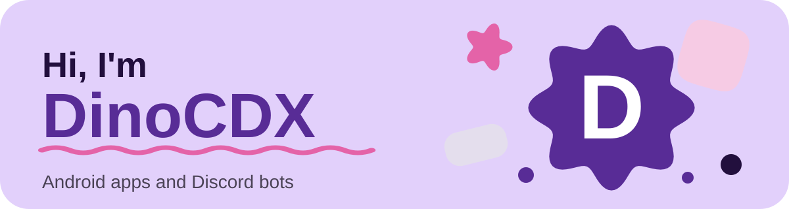
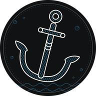

 

● ◆ ▲ ■ ● ◆ ▲ ■ ● ◆ ▲ ■

I'm a college student who builds Android apps and Discord bots. 
Python is what I'm strongest in, I'm learning Kotlin, and I read a lot of webnovels.

 

 

## ● Projects

### Discord Presence Manager

Puts what you're doing on your Android phone into your Discord status: the music, the video, the game or app you have open.

`Android 10+` `Kotlin` `Material 3 Expressive`

[Website](https://dinocdx.github.io/discord-presence-manager/) · [GitHub](https://github.com/DinoCDX/discord-presence-manager)

 

### GUMMM

Godot Universal Mod Manager Mobile. Add mods to Godot 3 and 4 games on Android, with no PC. It patches the game, signs it and installs it next to the original.

`Android 9+` `Godot` `Mobile port of GUMM`

[Website](https://dinocdx.github.io/GUMMM/) · [Download](https://github.com/DinoCDX/GUMMM/releases/latest) · [GitHub](https://github.com/DinoCDX/GUMMM)

 

### Minigames Ahoy!

Add Minigames Ahoy! to your Discord server. Use the community hub to ask questions, suggest games and features, and read official update announcements.

`Discord` `Suggestions` `Announcements`

[Add to Discord](https://discord.com/oauth2/authorize?client_id=1442543093634039859) · [Open issues](https://github.com/DinoCDX/minigames-ahoy-issues/issues)

 

## ◆ What I use

 

## ■ Say hi

Bug reports, feature ideas and novel recommendations are all welcome. Email me at [dinocdxreal@gmail.com](mailto:dinocdxreal@gmail.com) or open an issue on any project.

● ◆ ▲ ■ ● ◆ ▲ ■ ● ◆ ▲ ■

